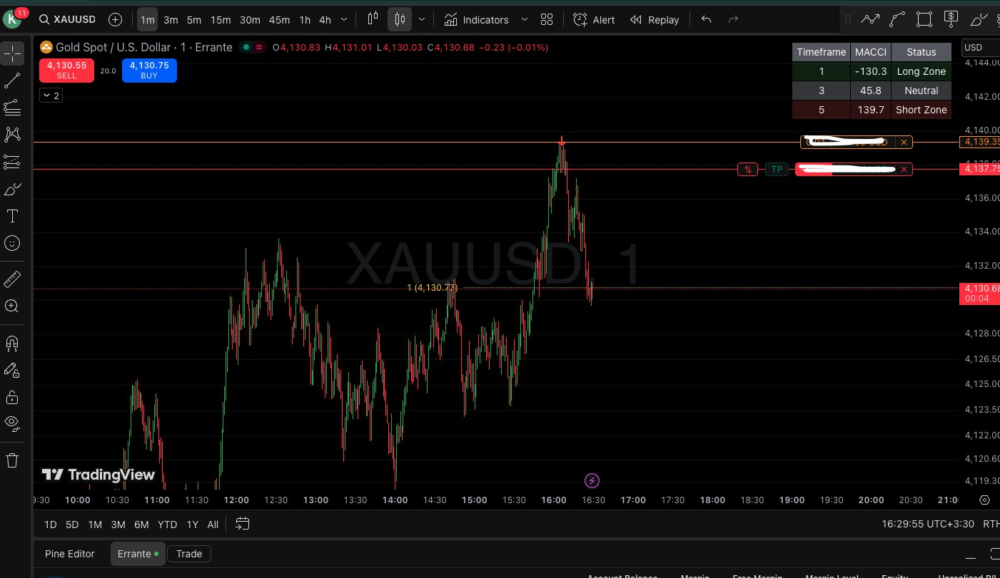
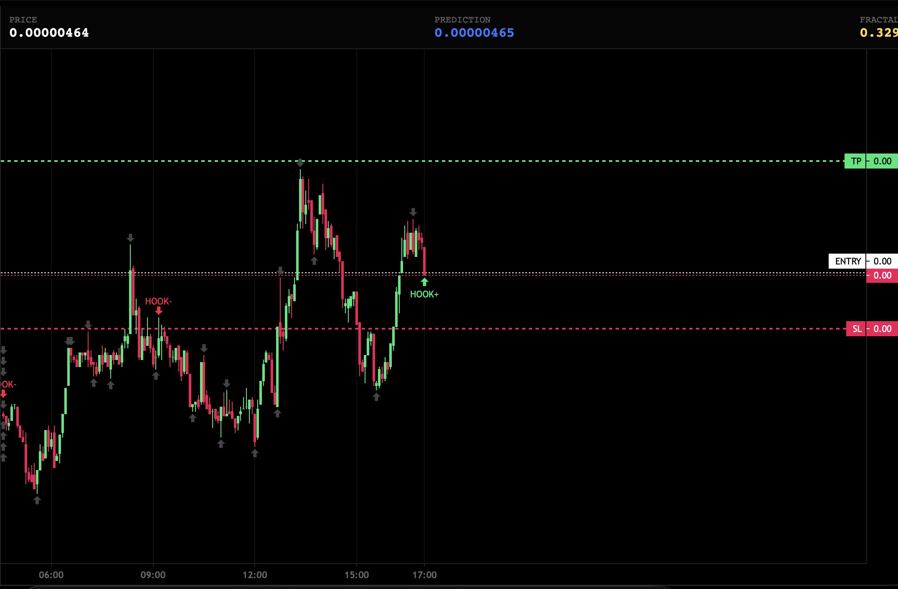
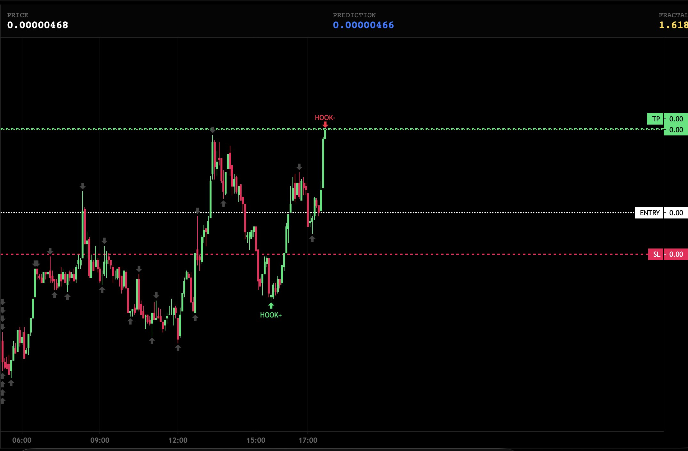
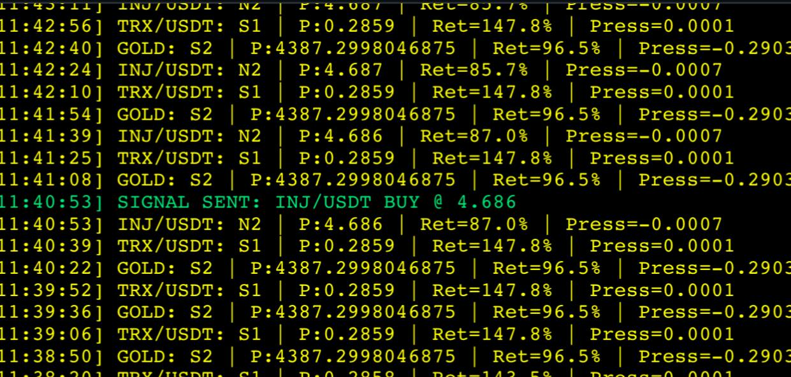
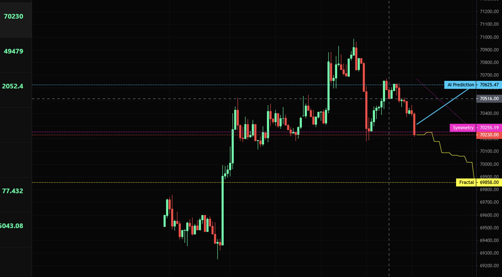
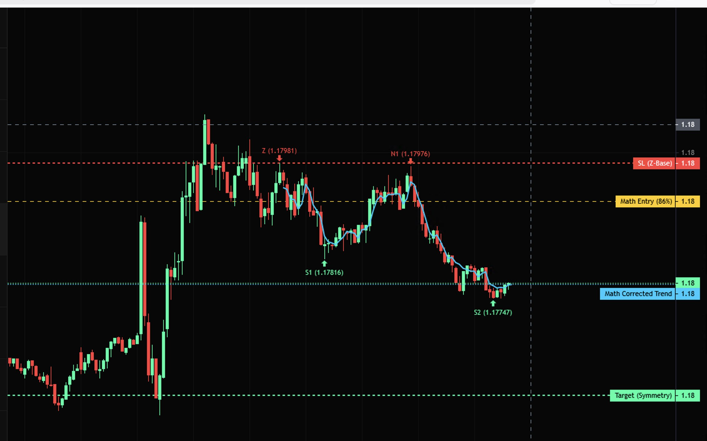

# Highlights

A few frames that show the system end to end.

### 2025-11-12 16:00 — TP

### 2025-11-30 20:41 — نمونه سیگنال های بات

### 2025-12-21 14:54 — در این کد TP ها بر اساس نود بعدی و Sl ها با محاسبه نوسان طبق متود GARCH محاسبه میشه
و کریپتو به دلیل نوستان شدید اصلا پیشنهاد نمیشه برای معامله 
اما در روز های تعطیل برای کالبره کردن میشه استفادش کرد

### 2026-02-15 13:08 — نتیجه

### 2026-02-20 19:41 — NMT Algo Visual

