

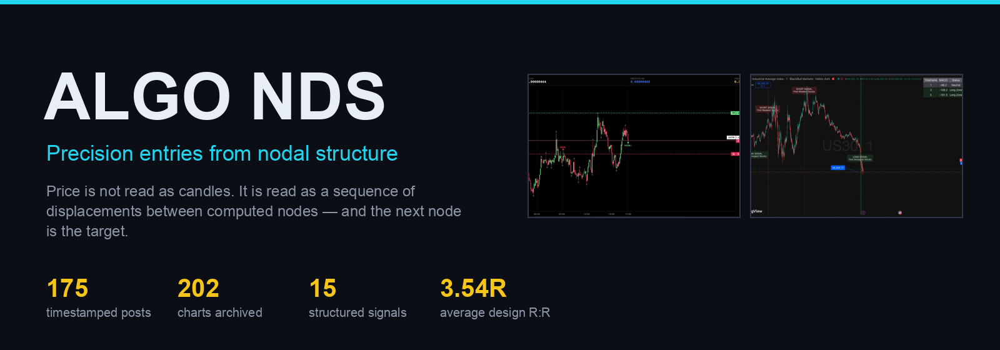

### 202 charts · 15 structured signals · one method

## [▶ &nbsp; Open the gallery &nbsp; →](https://alirezakkt.github.io/algo-nds-signals/)

202 charts in 50 day-sessions · before/after pairs highlighted · click any frame for full resolution

---

## Frames are grouped into sessions

A flat folder of 202 screenshots tells you nothing — the meaning is in the order. So the gallery opens on **Sessions**: every day's posts, threaded together, from the first chart to the outcome.

> **19 Oct 2025 · 7 frames · 09:48 → 23:17** — the chart, the update, the level that broke.

A session splits when two captions name different markets — a BTC chart and a Dow chart posted a minute apart are two stories, not one. `scripts/link_images.py` does that grouping from timestamps and tickers, never from pixel guessing: the charts were re-zoomed and re-tooled across the year, so visual similarity was measured and rejected as unreliable (known same-chart pairs scored anywhere between 0.35 and 0.86 cosine — full overlap with unrelated charts).

Switch to **All charts** for the flat archive.

---

| | | |
|:--:|:--:|:--:|
| [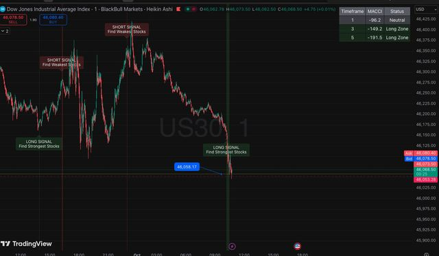](archive/2025-10/2025-10-01_1050/) | [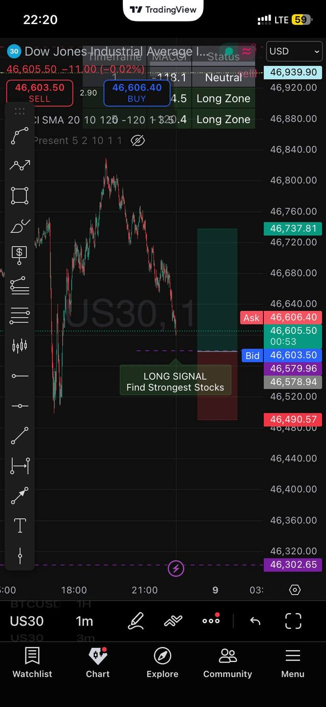](archive/2025-10/2025-10-08_2150/) | [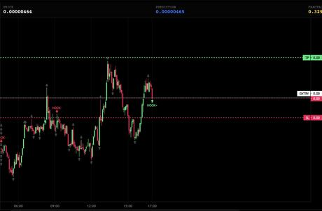](archive/2025-11/2025-11-30_2041/) |
| **2025‑10‑01** · first overlay on a live chart | **2025‑10‑08** · LONG SIGNAL, levels on the ladder | **2025‑11‑30** · bot signal output |

| | | |
|:--:|:--:|:--:|
| [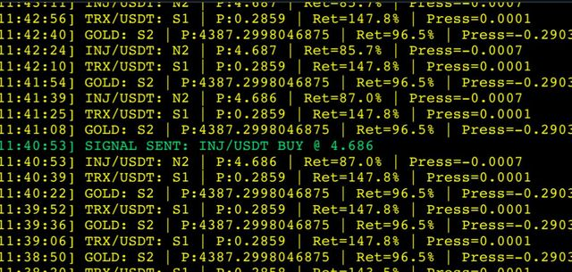](archive/2025-12/2025-12-21_1454/) | [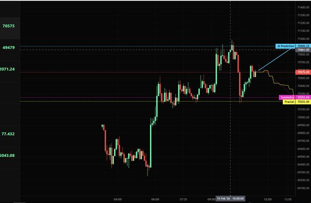](archive/2026-02/2026-02-15_1238/) | [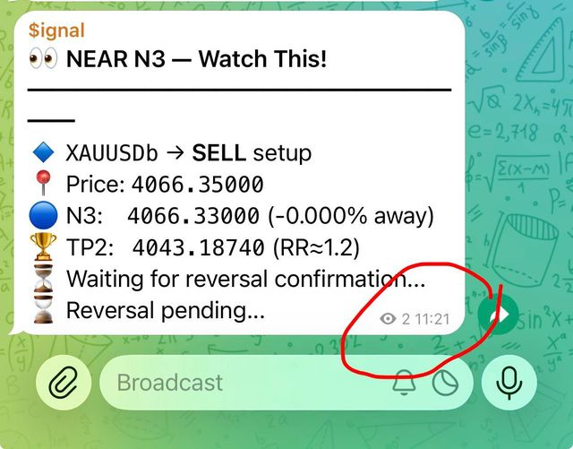](archive/2026-06/2026-06-29_1105/) |
| **2025‑12‑21** · TP from the next node, SL from GARCH | **2026‑02‑15** · prediction readout, live | **2026‑06‑29** · N3 signal card |

| | | |
|:--:|:--:|:--:|
| [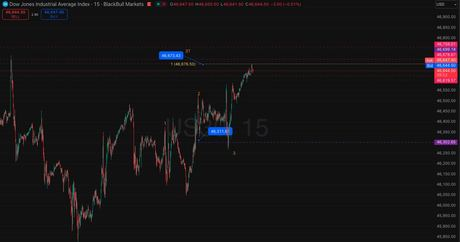](archive/2025-10/2025-10-03_1351/) | [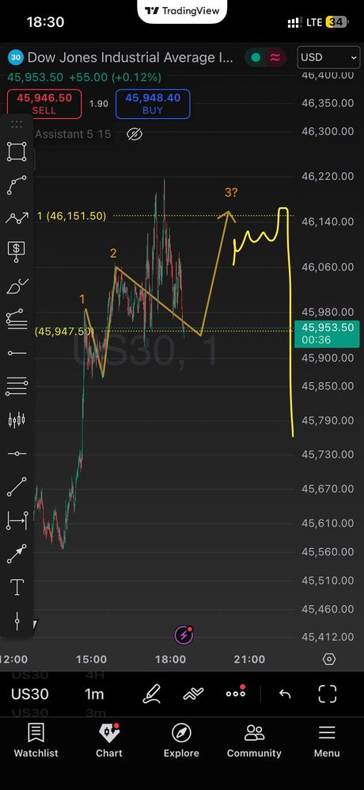](archive/2025-10/2025-10-17_1801/) | [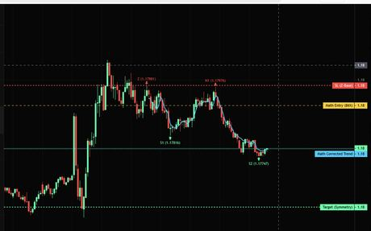](archive/2026-02/2026-02-20_1941/) |
| **2025‑10‑03** · "the market respects math, not drawings" | **2025‑10‑17** · sequence geometry projected forward | **2026‑02‑20** · NMT Algo visual layer |

### [**+ 193 more frames in the live gallery →**](https://alirezakkt.github.io/algo-nds-signals/#gallery)

---

## What you are looking at

**Swing points are computed, not eyeballed.** Price is read as a sequence of displacements between nodes; the next node becomes the target, and measured volatility becomes the stop. Nothing is drawn by hand and argued about afterwards.

| Step | What happens |
|:--|:--|
| **01 Nodes** | swing points via second derivative |
| **02 Sequence** | frame the legs — which displacement is in play |
| **03 Symmetry** | project the geometry: where the next leg lands |
| **04 Target** | next node = TP · structure decides the exit |
| **05 Stop** | GARCH volatility = SL · measured, not chosen |
| **06 Trigger** | fire inside the retracement zone, depth recorded |

---

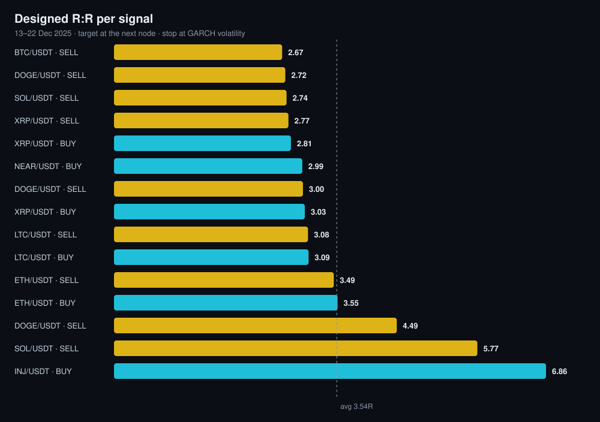 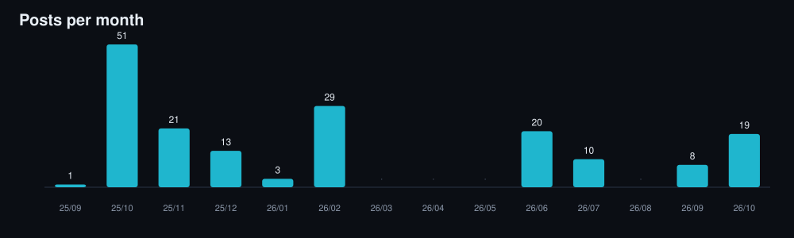

---

## Everything is traceable

| | |
|:--|:--|
| [`REPORT.md`](REPORT.md) | Full report — method, timeline, coverage, limitations |
| [`SIGNALS.md`](SIGNALS.md) | All 15 signals exactly as posted |
| [`INDEX.md`](INDEX.md) | Every screenshot, chronologically |
| `archive/` | 175 timestamped folders, 202 charts, `meta.json` each |
| `data/` | `signals.json` · `screenshots.json` |
| `scripts/` | `build_archive.py` · `link_images.py` · `make_visuals.py` · `make_site.py` |

Pick any row in [`SIGNALS.md`](SIGNALS.md), take its timestamp, open the matching folder — the chart the engine was looking at is there. No "trust me" required.

---

## The honest line

**No win rate is claimed here.** The source data contains no outcome field — not one of the 15 signals has a recorded exit. The 3.54R is *designed* reward-to-risk, not realised profit. Charts were annotated live but are still selected posts, and four months of the period have no posts at all.

What is claimed is narrower: **the method is documented, the numbers are traceable, and the reasoning is reproducible.** Attach an outcome ledger and the whole thing becomes checkable — the structure for that is already in the repo.

---

<b>Educational research · not financial advice · not a signal service</b> 
Charts: TradingView · engine and annotations: AliReza V.

